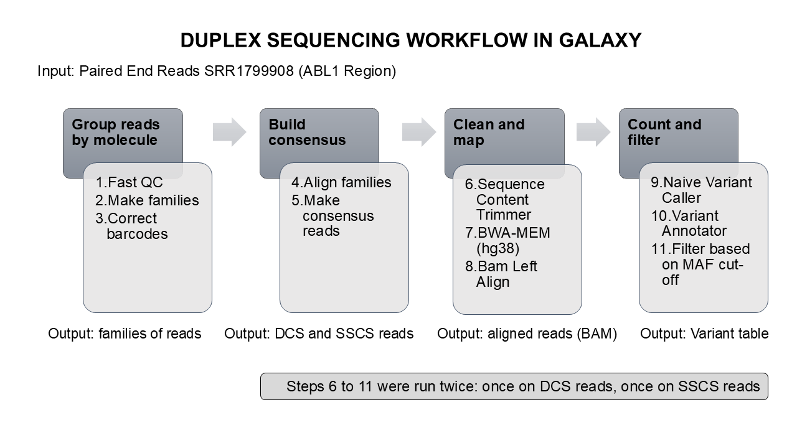
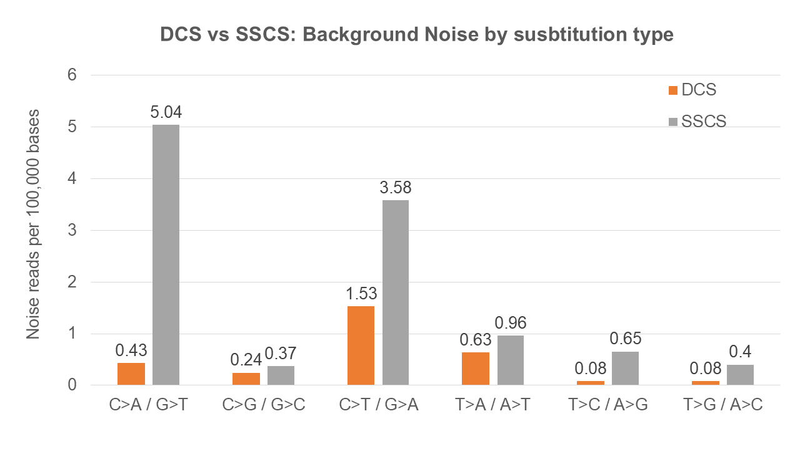
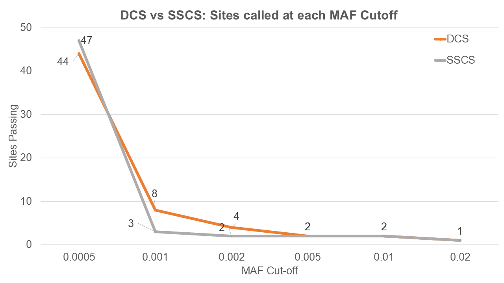

# Detecting a 1% ABL1 variant and measuring error suppression

This is a dry-lab NGS project run in [Galaxy](https://usegalaxy.org). It reproduces the Galaxy Training Network tutorial [Calling very rare variants](https://training.galaxyproject.org/training-material/topics/variant-analysis/tutorials/dunovo/tutorial.html), then extends it with my own analysis. I compare duplex consensus (DCS) and single-strand consensus (SSCS) reads to measure how much background noise duplex sequencing removes, and where variant calling at low allele frequencies breaks down.

## Author and Motivation
Anusuya Narayanan, an assay development scientist in DNA-FISH for haemato-oncology. My direct laboratory experience is centred on DNA-FISH, imaging-based cytogenomics and flow-cytometry. To build on this foundation, I am developing foundational NGS data-analysis skills through this Galaxy-based project, and I am eager to extend my experience in assay development and image analysis into NGS and multi-omics. 

*Personal learning project using public data and open-source tools, done in my own time. Not affiliated with or endorsed by any employer.*

## Key Results
- **Reproduced the published call.** The rare ABL1 variant chr9:130,872,141 G>A was detected at **1.19%** in duplex reads (15 of 1,259 molecules), against 1.26% in the tutorial. The heterozygous germline SNP rs2227985 sat at 48.2%, as expected.
- **Duplex consensus cut background noise 3.7-fold** (3.0 × 10⁻⁵ vs 1.1 × 10⁻⁴ noise reads per base) and **oxidative-damage noise (C>A / G>T) about 12-fold.**
- **The cost is depth.** Requiring both strands left 5.2 times fewer reads (23,169 vs 121,359 read pairs; median depth 1,572 vs 7,476).
- **A MAF cut-off alone is misleading below 0.5%.** At low depth, a single read already exceeds 0.1%, so a minimum number of supporting reads is needed alongside the MAF cut-off.

## Data

| Item | Value |
|---|---|
| Sample | ABL1 duplex sequencing library from Schmitt et al. (2015), [PMC4414912](https://www.ncbi.nlm.nih.gov/pmc/articles/PMC4414912/) |
| Accession | SRA [SRR1799908](https://www.ncbi.nlm.nih.gov/sra/?term=SRR1799908), paired-end |
| Reference | Human hg38, chr9 |
| Galaxy server | Galaxy History (https://galaxy-main.usegalaxy.org/u/narayanan.anusuya/h/calling-variants-dsc-1) |

The data is a deep, targeted sequencing run of the ABL1 gene region on chromosome 9, from Schmitt et al. (2015), SRA accession SRR1799908. Every original DNA molecule carries a random barcode of 12bp tag, so reads can be traced back to the molecule and the strand they came from. Du Novo joins the two 12-letter tags into a 24-letter barcode, then uses the tag order to label each read as coming from one strand or the other.

## Workflow

1. **FastQC**: reads the FASTQ file and performs a quality check.
2. **Du Novo: Make families**: split the 12 bp tag off each read, join the two tags into a 24 bp barcode, then group reads by molecule and label each strand as "ab" or "ba", to distinguish the top and bottom strand.
3. **Correct barcodes**: finds barcodes that differ by only a few letters and are probably the same molecule, then merges them. Setting used: maximum differences 3
4. **Align families**: runs a multiple sequence alignment (Kalign2) within each family, so that the same position lines up in the same column before voting.
5. **Make consensus reads (SSCS and DCS)**: removes errors that hit only a few reads, such as most sequencer errors and late PCR errors. Single-strand consensus per strand (min 3 reads, 70% agreement); and duplex consensus where positions on which both strands disagree become N.
6. **Sequence Content Trimmer**: removes reads with too many Ns. Setting used: 10 bp window, more than 2 non-ACGT bases; drop pairs shorter than 50 bp.
7. **BWA-MEM**: map consensus reads to the reference human genome hg38. 
8. **BamLeftAlign**: standardise indel positions, moves it to the leftmost possible position.
9. **Naive Variant Caller**: count bases at each chr9 position. It is “naive” because it makes no assumption about how many copies of a chromosome a cell has. Setting used: min mapping quality 20, min base quality 0, ploidy 1.
10. **Variant Annotator**: turns the VCF into a table with per-position depth, major/minor allele, MAF and strand bias (keeps positions with at least 10 reads in each read direction).
11. **Filter**: keeps positions with MAF at or above a cut-off (1% as in the tutorial, 0.005%- 2% in the sweep)

Steps 6 to 11 were run twice, once on DCS reads and once on SSCS reads.

### Tool versions and settings

| Step | Tool (version) | Key settings |
|---|---|---|
| Quality check | FastQC (0.74+galaxy1) | defaults |
| Families | Du Novo: Make families (3.0.2) | tag length 12, invariant length 5 |
| Barcode correction | Du Novo: Correct barcodes (3.0.2) | max differences 3 |
| Family alignment | Du Novo: Align families (3.0.2) | Kalign2 |
| Consensus | Du Novo: Make consensus reads (3.0.2) | min reads 3, threshold 0.7, SSCS output on |
| Trimming | Sequence Content Trimmer (0.2.3) | ACGT inverted, frequency 0.2, window 10, min length 50 |
| Mapping | BWA-MEM (0.7.19) | hg38 |
| Indel normalisation | BamLeftAlign (1.3.10) | hg38 |
| Base counting | Naive Variant Caller (0.0.4) | chr9, MAPQ 20, base quality 0, ploidy 1 |
| Annotation | Variant Annotator (1.3.2) | MAF threshold 0, coverage 10, stranded counts on |
| Filter | Filter | `c16 >= 0.01`, 1 header line |

Reason for difference from published results:
The tutorial used BWA-MEM 0.7.18 and BamLeftAlign 1.3.8; my run used BWA-MEM 0.7.19 and BamLeftAlign 1.3.10. The newer versions are the most likely reason my DCS frequency (1.19%) differs slightly from the published one (1.26%).

## Results

### 1. Variant calls at the tutorial cut-off (MAF ≥ 1%)

| Site (hg38) | Change | DCS | SSCS |
|---|---|---|---|
| chr9:130,872,141 (ABL1, rare variant) | G>A | 15 / 1,259 reads, MAF 0.01191 | 71 / 7,083 reads, MAF 0.01002 |
| chr9:130,880,141 (rs2227985, germline) | A>G | 679 / 1,408 reads, MAF 0.48224 | 3,634 / 7,533 reads, MAF 0.48241 |

Both methods call the same two sites at 1%. The rare-variant frequencies agree within sampling error: with 15 supporting reads, the DCS estimate has a 95% interval of roughly 0.6% to 1.8%.

### 2. Background noise

All minor-allele reads left after removing the two real sites:

| Measure | DCS | SSCS |
|---|---|---|
| Positions with at least one noise read | 75 of 1,639 (5%) | 964 of 1,891 (51%) |
| Noise reads per base | 	3.0 × 10⁻⁵ | 1.1 × 10⁻⁴ |
| C>A / G>T noise per base | 	4.3 × 10⁻⁶ | 5.0 × 10⁻⁵ |
| C>T / G>A noise per base | 1.5 × 10⁻⁵ | 3.6 × 10⁻⁵ |

C>A / G>T changes make up 46% of SSCS noise. This is the typical signature of 8-oxoguanine, oxidative damage to one strand during sample preparation. Because it sits on one strand only, the duplex step removes it almost entirely. C>T / G>A (deamination-type) changes are reduced only about 2-fold and form the largest share of what remains in DCS. Damage or end-repair artefacts copied onto both strands, and real variants present in a single molecule, look like this.

### 3. Threshold sweep

Sites passing each MAF cut-off (Filter on column 16):

| MAF cut-off | DCS sites | SSCS sites |
|---|---|---|
| 0.02 | 1 | 1 |
| 0.01 | 2 | 2 |
| 0.005 | 2 | 2 |
| 0.002 | 4 | 2 |
| 0.001 | 8 | 3 |
| 0.0005 | 44 | 47 |

At 0.1% to 0.3%, DCS passes *more* sites than SSCS. This is a depth effect, not extra noise. Every extra DCS site is a single duplex read at a position with fewer than 1,000 reads, where one read is already 0.1% to 0.3%. SSCS has about five times the depth, so its single noise reads stay below the cut-off. Adding a minimum of 3 supporting reads removes these: DCS then calls only the two real sites at every cut-off from 0.0005 to 0.01, while SSCS, with no MAF cut-off, still has 126 sites with 3 or more supporting reads.

## Conclusions

1. Duplex consensus detected a real 1% subclonal variant with very low background, and removed most single-strand damage that single-strand consensus keeps.
2. The price is depth. With about 1,500 duplex molecules per position here, roughly 0.2% is the lowest frequency that 3 independent molecules can support. Deeper sequencing or more input DNA would push that lower.
3. Call thresholds should combine a frequency cut-off with a minimum number of supporting molecules. A frequency cut-off alone inflates the call count for whichever method has fewer reads.

## Limitations

- **One sample, one small target.** A single public dataset over a few kilobases of ABL1. The noise figures describe this library, not duplex sequencing in general.
- **No truth set below 1%.** Without known spiked-in variants, sites below 1% can't be scored as true or false positives. The next step is an in-silico dilution series with variants added at known frequencies.
- **Molecules, not cells.** MAF counts DNA molecules. Converting to a fraction of cells needs copy-number information (for a heterozygous change, 1% of molecules ≈ 2% of cells).
- **Single-base changes only.** Indels were not analysed.
- **Coverage threshold.** The Variant Annotator drops positions with fewer than 10 reads, which most likely explains the 252 positions reported for SSCS but not DCS.

## Repository contents

| Path | What it holds |
|---|---|
| `results/variant_calls.csv` | Sites passing MAF ≥ 0.01, both methods |
| `results/threshold_sweep.csv` | Sites passing each MAF cut-off |
| `results/background_error.csv` | Noise reads per base, both methods |
| `results/substitution_spectrum.csv` | Noise by substitution class |
| `results/read_counts.csv` | Consensus read pairs before and after trimming |
| `Figures/` | Plots used above |
| `scripts/duplex_sweep.py` | Rebuilds the results tables |

This writes the CSVs to `results/` and the plots to `figures/`. With `--min-reads`, the threshold-sweep figure gains a second panel showing the cut-off combined with a minimum number of supporting reads.

## Disclaimer
Galaxy analyses were run and checked by me. Drafting of the README and figures was assisted by Claude (Anthropic).

## References

- Galaxy Training Network. [Calling very rare variants](https://training.galaxyproject.org/training-material/topics/variant-analysis/tutorials/dunovo/tutorial.html).
- Schmitt MW et al. (2015). Sequencing small genomic targets with high efficiency and extreme accuracy. *Nature Methods*. [PMC4414912](https://www.ncbi.nlm.nih.gov/pmc/articles/PMC4414912/).
- Du Novo source code: [github.com/galaxyproject/dunovo](https://github.com/galaxyproject/dunovo).
